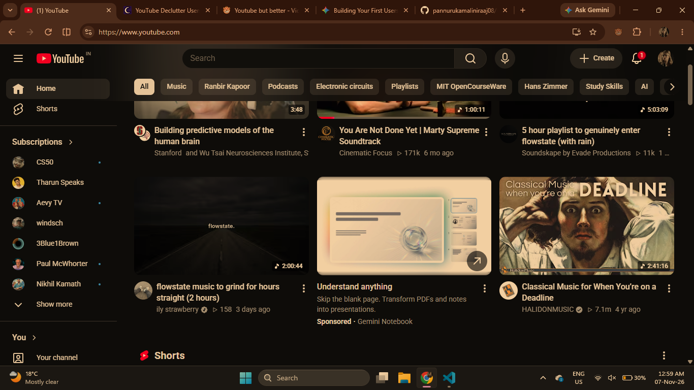
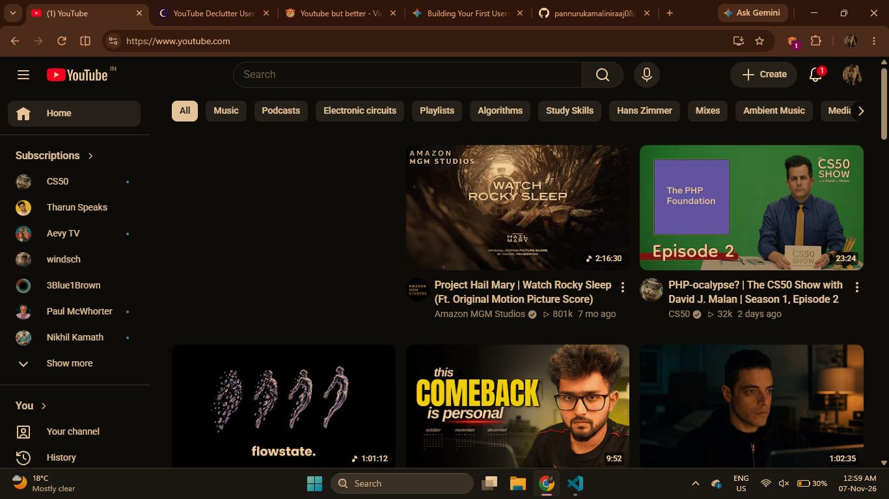

# Userscript
# Youtube but better

## Features
- **Ad & Sponsor Blocker:** Automatically hides feed ad slots and sponsor recommendation links.
- **Shorts Remover:** Cleanly strips YouTube Shorts out of the sidebar and feed so you can stay focused.
- **Speed Control Shortcuts:** Press `]` to speed up or `[` to slow down videos smoothly on the fly.

## How to Install

Because this is a custom userscript, you'll need a userscript manager installed in your browser.

1. **Install a Userscript Manager:**
   - Install [Violentmonkey](https://violentmonkey.github.io/) (recommended) or Tampermonkey for Chrome, Firefox, or Edge.
   - *Note for Chrome users:* Right-click your manager's extension icon, pick **Manage extension**, and toggle on **Allow user scripts** so your local scripts are allowed to run.

2. **Install the Script:**
   - [Click here to install the userscript directly from GitHub!](https://raw.githubusercontent.com/pannurukamaliniraaj08/Userscript/main/userscript.user.js)
   - Your userscript manager will automatically pop up and ask you to confirm the installation.

3. **Enjoy YouTube:**
   - Open up [YouTube](https://www.youtube.com) and watch your clean feed in action!

## Before & After

- **Before:** Standard cluttered YouTube feed with ads and Shorts.

- **After:** Clean, distraction-free feed.

